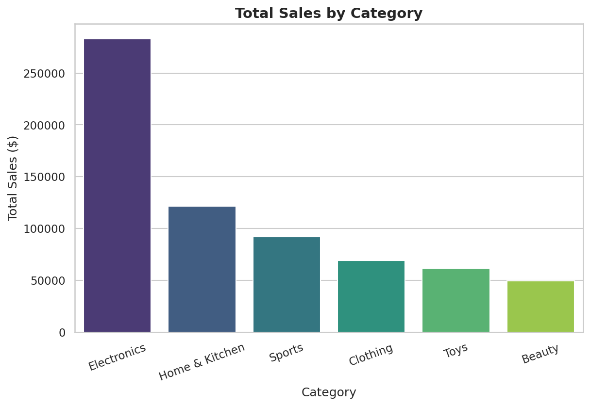
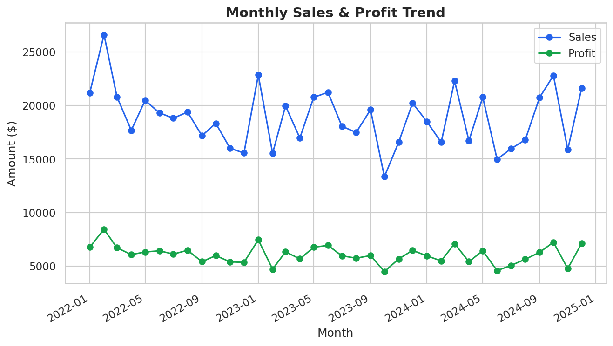
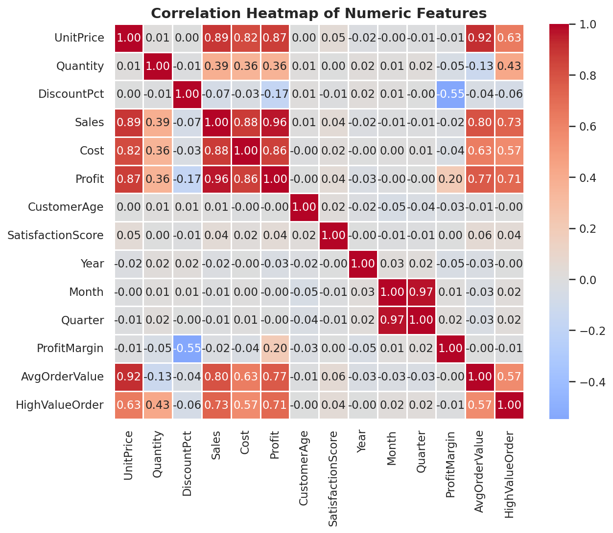
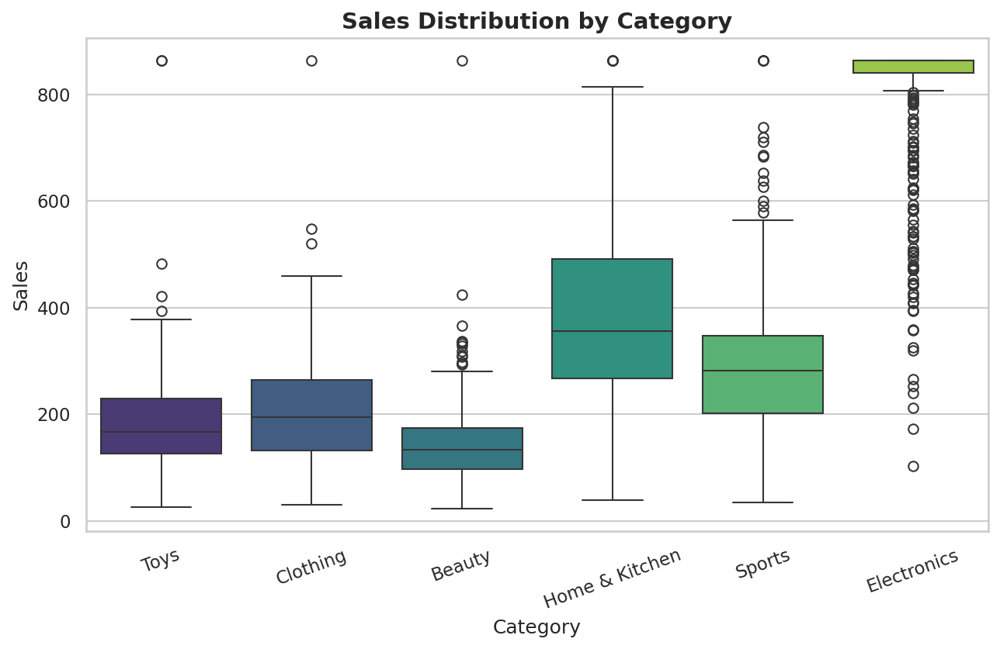

# 📊 Retail Sales Analytics & Prediction

An end-to-end data analytics project that transforms raw, messy retail
sales data into cleaned datasets, statistical insights, professional
visualizations, machine learning predictions, and an interactive
Streamlit dashboard.


---

## 📝 Project Description

This repository simulates a real-world retail analytics engagement: a
multi-category, multi-region sales dataset is loaded, cleaned,
explored, and modeled to answer business questions such as *which
categories drive revenue*, *how does profit trend over time*, and
*can we predict order value and identify high-value orders?*

The project is fully modular (`src/`), reproducible
(`run_pipeline.py`), and includes a polished report (Markdown / HTML /
PDF) plus an interactive dashboard.

## ✨ Features

- 🧹 **Data Cleaning** — missing value imputation, duplicate removal, IQR-based outlier capping
- 🛠️ **Feature Engineering** — time-based features, profit margin, average order value, high-value flag
- 📈 **Exploratory Data Analysis** — category, regional, and monthly trend analysis
- 🔗 **Correlation Analysis** — full numeric correlation heatmap
- 🤖 **Machine Learning** — Random Forest regression (Sales) & classification (High-Value Orders)
- 🖼️ **13 Professional Visualizations** — bar, line, pie, histogram, scatter, heatmap, box plot, distribution, feature importance, prediction vs actual, confusion matrix, ROC curve, residual plot
- 📄 **Report in 3 Formats** — Markdown, HTML, and PDF
- 📊 **Interactive Streamlit Dashboard** — filters, KPIs, charts, model predictions, CSV downloads
- 📓 **Executed Jupyter Notebook** — step-by-step reproducible analysis

## 📂 Dataset

A synthetic but realistic retail dataset (`data/raw/sales_data.csv`,
generated by `data/raw/generate_dataset.py`) with **2,015 orders**
across **6 categories**, **5 regions**, and **3 years** (2022–2024),
including intentionally messy data (missing values, duplicates,
outliers) to demonstrate a realistic cleaning workflow.

| Column | Description |
|---|---|
| `OrderID` | Unique order identifier |
| `Date` | Order date |
| `Category`, `Product` | Product taxonomy |
| `Region` | Sales region |
| `UnitPrice`, `Quantity`, `DiscountPct` | Transaction attributes |
| `Sales`, `Cost`, `Profit` | Financial outcomes |
| `CustomerAge`, `SatisfactionScore` | Customer attributes |

> Swap in your own dataset by replacing `data/raw/sales_data.csv` with
> matching columns, or adjust `src/preprocessing.py` accordingly.

## ⚙️ Installation

```bash
# 1. Clone the repository
git clone https://github.com/<your-username>/retail-sales-analytics.git
cd retail-sales-analytics

# 2. Create a virtual environment (recommended)
python3 -m venv venv
source venv/bin/activate      # On Windows: venv\Scripts\activate

# 3. Install dependencies
pip install -r requirements.txt
```

## 📦 Requirements

- Python 3.10+
- pandas, numpy, matplotlib, seaborn
- scikit-learn
- streamlit, plotly, statsmodels
- reportlab, jupyter, nbconvert

See [`requirements.txt`](requirements.txt) for pinned versions.

## 🗂️ Project Structure

```
Project/
│
├── data/
│   ├── raw/                # Raw generated dataset + generator script
│   └── processed/          # Cleaned dataset
│
├── reports/
│   ├── report.md            # Markdown report
│   ├── report.html          # HTML report
│   └── report.pdf           # PDF report
│
├── graphs/                  # All 13 generated chart images
│
├── dashboard/
│   ├── app.py                # Streamlit dashboard
│   └── requirements.txt
│
├── notebooks/
│   └── analysis.ipynb        # Executed exploratory notebook
│
├── src/
│   ├── preprocessing.py      # Cleaning & feature engineering
│   ├── analysis.py           # EDA & statistical summaries
│   ├── visualization.py      # Chart generation
│   ├── model.py               # ML training & evaluation
│   └── utils.py                # Logging & shared helpers
│
├── outputs/
│   ├── cleaned_dataset.csv
│   ├── summary_statistics.csv
│   └── prediction_results.csv
│
├── run_pipeline.py            # Master pipeline entry point
├── requirements.txt
├── README.md
├── LICENSE
└── .gitignore
```

## ▶️ How to Run

**1. Run the full analytics pipeline** (cleans data, generates all
charts, trains models, saves outputs):

```bash
python run_pipeline.py
```

**2. Launch the interactive dashboard:**

```bash
streamlit run dashboard/app.py
```

**3. Explore the notebook:**

```bash
jupyter notebook notebooks/analysis.ipynb
```

**4. View the report:** open `reports/report.html` in a browser, or
`reports/report.pdf` for the print-ready version.

## 🖼️ Screenshots

| Sales by Category | Monthly Trend |
|---|---|
|  |  |

| Correlation Heatmap | Sales Distribution by Category |
|---|---|
|  |  |

## 📊 Dashboard Preview

The Streamlit dashboard includes sidebar navigation, category/region/date
filters, KPI cards (Total Sales, Total Profit, Orders, Avg. Profit
Margin), interactive Plotly charts, a data-cleaning summary, a model
prediction explorer, and CSV download buttons.

```bash
streamlit run dashboard/app.py
```

## 📈 Sample Results

| Metric | Value |
|---|---|
| Total Sales | $677,423 |
| Total Profit | $218,695 |
| Avg. Order Value | $338.71 |
| Avg. Profit Margin | 32.4% |

**Regression model (predicts order Sales):** MAE 18.73 · RMSE 44.09 · R² 0.971

**Classification model (predicts High-Value Order):** Accuracy 0.980 · F1 0.980 · ROC AUC 0.998

See [`reports/report.md`](reports/report.md) for full business
insights and recommendations.

## 🛠️ Technologies Used

- **Language:** Python 3
- **Data Processing:** pandas, numpy
- **Visualization:** matplotlib, seaborn, plotly
- **Machine Learning:** scikit-learn (Random Forest)
- **Dashboard:** Streamlit
- **Reporting:** Markdown, pandoc (HTML), reportlab (PDF)
- **Notebook:** Jupyter / nbformat / nbconvert

## 🚀 Future Improvements

- Incorporate real transactional data with seasonality/holiday effects
- Add time-series forecasting models (Prophet, ARIMA)
- Add customer-level features (lifetime value, repeat-purchase rate)
- Add CI (GitHub Actions) to re-run the pipeline and lint on every push
- Deploy the dashboard (Streamlit Community Cloud / Docker) with auth

## 📄 License

This project is licensed under the [MIT License](LICENSE).

## 👤 Author

**Data Analytics Team**
Feel free to open an issue or pull request with questions or suggestions.
